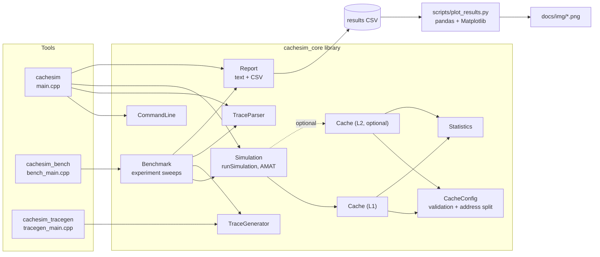

# CacheSim: a configurable CPU cache simulator in C++17

CacheSim replays a memory-access trace through a model of a CPU cache and reports hits, misses, evictions and memory traffic. You can change the capacity, block size, associativity, replacement policy, write policy and write-allocation policy, add an optional L2 cache, and sweep those parameters automatically to see how each one affects the results.

It is a **functional** simulator: it tracks which blocks are in the cache, not data values or time. Everything it prints is a property of the model and the trace, not a measurement of real hardware (see [Limitations](#limitations)).

## Motivation

Caches hide the gap between processor and memory speed, so understanding them is basic to computer architecture and to writing fast code. I built this project to learn the mechanics by implementing them: address decomposition, set mapping, replacement and write policies, and multi-level traffic. Each piece is covered by tests with hand-calculated expected results, and the experiments can be reproduced with the commands below.

## Features

- Configurable capacity, block size and associativity: direct-mapped, 2/4/8-way (any power of two) and fully associative.
- LRU and FIFO replacement; write-through and write-back; write-allocate and no-write-allocate.
- Optional L2 cache with documented assumptions, and a model-based AMAT estimate with configurable latencies.
- Trace parser with validation and `file:line:` error messages; text report and CSV output.
- Synthetic trace generator (sequential, random, hot set, strided), deterministic for a given seed.
- Benchmark runner that sweeps associativity, replacement, capacity, block size, write policy and L2 size on the same traces and writes one CSV; pandas/Matplotlib plotting script.
- 20 CTest tests: unit tests with hand-calculated expectations, a randomized differential test against an independent reference model, and end-to-end tests of the executables.

## Cache fundamentals

A cache stores recently used **blocks** (lines) of memory. An address is split into three fields:

```
 63                                         offset bits
 +------------------+-----------------+----------------+
 |       tag        |    set index    |  block offset  |
 +------------------+-----------------+----------------+
   identifies the     which set the     byte within the
   block in its set   block maps to     block
```

- block offset = log2(block size) low bits
- set index = the next log2(number of sets) bits
- tag = all remaining high bits
- number of sets = capacity / (block size x ways)

Example (from the tests): 1 KiB direct-mapped cache, 16 B blocks, so 64 sets, 4 offset bits, 6 index bits. Address `0x1234` has offset 4, set index 35 and tag 4 (check: 4x1024 + 35x16 + 4 = 4660 = 0x1234).

### Organizations

| Organization | Ways per set | Sets | Trade-off |
|---|---|---|---|
| Direct-mapped | 1 | = number of lines | simplest and fastest lookup; blocks that share an index evict each other (conflicts) |
| N-way set-associative | N | lines / N | a block can live in any of N ways of its set; fewer conflicts, more comparators |
| Fully associative | all lines | 1 | no conflict misses; every line must be searched |

In the simulator all three are the same code: a set has `ways` lines, and only that number differs.

### Replacement: LRU vs FIFO

When a set is full, one line must be evicted.

- **LRU** evicts the line used longest ago. A hit refreshes the line's recency.
- **FIFO** evicts the line that was inserted first. A hit changes nothing.

Both are implemented with one per-line logical-clock stamp: the victim is the line with the smallest stamp. FIFO writes the stamp only on fill; LRU also writes it on every hit. Neither policy wins on every trace: on `A B A C A` in a 2-way set LRU keeps the hot block `A` (2 hits vs 1), while on `A B C B A C B` FIFO happens to do better (2 hits vs 1). Both are in `tests/test_replacement.cpp`.

### Write policies

- **Write-through**: every store is also sent to the next level. Memory stays up to date and lines are never dirty, but there is a lot of write traffic.
- **Write-back**: a store only marks the line dirty; the data is written to the next level when the dirty line is evicted. Less traffic, but dirty data lives only in the cache until then.

### Write-allocate vs no-write-allocate

- **Write-allocate**: a write miss fetches the block into the cache, then writes it (the model assumes the whole block is fetched first). Good when written data is read or written again soon.
- **No-write-allocate**: a write miss goes straight to the next level and the cache is untouched. Good for write-once streaming data.

Common pairings are write-back + write-allocate and write-through + no-write-allocate, but the simulator accepts all four combinations.

### Miss types

- **Compulsory** misses: the first reference to a block.
- **Capacity** misses: the working set is larger than the cache, so blocks are evicted before reuse.
- **Conflict** misses: the block was evicted only because too many blocks map to the same set; a fully associative cache of the same size would have hit.

**This simulator does not classify misses into these three types.** Doing it properly needs extra machinery (a record of every block ever seen, plus a parallel fully associative cache of equal size). The conflict-miss effect is visible indirectly in the experiments below, for example the `strided` trace.

## Architecture



Simulation logic (`Cache`, `CacheConfig`, `Simulation`) knows nothing about command-line parsing, files or printing. Reporting only formats results. `main.cpp` just wires them together.

### Project layout

```
CacheSim/
  CMakeLists.txt
  include/        headers: Cache, CacheConfig, CacheLine, Statistics, Access, Latency,
                  Simulation, TraceParser, TraceGenerator, CommandLine, Report, Benchmark
  src/            implementations + main.cpp, bench_main.cpp, tracegen_main.cpp
  tests/          13 unit-test executables + TestUtil.h
  traces/         sample.trace
  scripts/        plot_results.py, requirements.txt
  results/        sample_results.csv (generated by cachesim_bench, see below)
  docs/           this project's plots (docs/img) and INTERVIEW_PREP.md
```

## Build and run

Requires CMake 3.14+ and a C++17 compiler (GCC, Clang, MSVC or MinGW). No external libraries.

### Linux / macOS

```
cmake -S . -B build
cmake --build build
ctest --test-dir build --output-on-failure
./build/cachesim --trace traces/sample.trace
```

### Windows prerequisites

Install the free "Build Tools for Visual Studio 2022" and select the "Desktop development with C++" workload (it includes the MSVC compiler and CMake). Then open "Developer Command Prompt for VS 2022" and run the commands below from the project folder. If `cmake` is not found, install CMake from cmake.org (tick "add to PATH") or run `winget install Kitware.CMake`. For the plotting scripts install Python 3 and use `py` (or `python`).

### Windows with Visual Studio (Developer Command Prompt)

```
cmake -S . -B build
cmake --build build --config Debug
ctest --test-dir build -C Debug --output-on-failure
build\Debug\cachesim.exe --trace traces\sample.trace
```

### Windows with MinGW-w64

```
cmake -S . -B build -G "MinGW Makefiles"
cmake --build build
ctest --test-dir build --output-on-failure
build\cachesim.exe --trace traces\sample.trace
```

`--test-dir` needs CMake 3.20 or newer; on older versions run `cd build` then `ctest -C Debug`.

The project was developed and verified with GCC 13 and CMake on Linux. The build flags are configured for MSVC (`/W4`) as well as GCC/Clang/MinGW (`-Wall -Wextra -Wpedantic`).

### Trace format

```
R 0x00001000     # R = read, W = write, hexadecimal address with 0x prefix
W 0x2000         # '#' starts a comment; blank lines are ignored
```

Addresses are 64-bit, leading zeros are fine, CRLF line endings and a UTF-8 BOM are accepted. Malformed lines are reported with their file and line number, for example `t.trace:4: unknown access type 'X' (expected R or W)`.

### Example commands

```
cachesim --trace traces/sample.trace
cachesim --trace traces/sample.trace --assoc 1 --csv
cachesim --trace traces/sample.trace --size 4K --block 32 --assoc full --replacement fifo
cachesim --trace traces/sample.trace --write-policy wt --write-miss no-allocate
cachesim --trace traces/sample.trace --size 1K --assoc 2 --l2-size 8K --l2-assoc 4
cachesim --help
```

Options: `--size`, `--block` (bytes, `K/M/G` suffixes allowed), `--assoc N|full`, `--replacement lru|fifo`, `--write-policy wb|wt`, `--write-miss allocate|no-allocate`, `--l2-size/--l2-block/--l2-assoc/--l2-replacement`, `--l1-latency/--l2-latency/--mem-latency`, `--csv`, `--no-header`. Exit codes: 0 success, 1 runtime error (e.g. missing file), 2 usage, configuration or trace-format error.

### Output of the default configuration on the sample trace

This is the actual output of `cachesim --trace traces/sample.trace` (32 KiB, 4-way, 64 B blocks, LRU, write-back, write-allocate):

```
CacheSim result (functional simulation; not a hardware measurement)
Trace: traces/sample.trace

Cache
  Capacity:       32768 bytes
  Block size:     64 bytes
  Associativity:  4-way set-associative (128 sets)
  Replacement:    LRU
  Write policy:   write-back
  Write miss:     write-allocate
  Accesses:       35
    Reads:        31  (hits 17, misses 14, hit rate 54.84%)
    Writes:       4  (hits 3, misses 1, hit rate 75.00%)
  Hits:           20  (57.14%)
  Misses:         15  (42.86%)
  Evictions:      10  (dirty 1)
  Traffic to memory (transactions, not bytes): 15 block fetches, 1 writes
  Dirty lines still resident at the end (not flushed): 1

Estimated AMAT (model-based estimate in cycles; not a hardware measurement)
  Model: L1 hit + L1 miss rate x memory
  Assumed latencies: L1 hit 4, memory 200 cycles
  Estimated AMAT: 89.71 cycles
```

The sample trace is deliberately tiny (35 accesses) so the numbers can be checked by hand; its five blocks 0x2000 apart collide in this particular 4-way geometry, so do not read general conclusions about associativity from it.

## Two-level caches and the AMAT estimate

Add an L2 with `--l2-size`. Assumptions (also stated in `Simulation.h`):

- L2 is non-inclusive, non-exclusive: it is not forced to contain L1's blocks.
- L2 only sees traffic leaving L1: an L1 block fetch becomes an L2 read, an L1 dirty-victim writeback becomes an L2 write to that block, and a forwarded store (write-through, or a no-write-allocate miss) becomes an L2 write. The writeback is issued before the fetch.
- L2 is write-back + write-allocate; its replacement policy and associativity are configurable.
- L2 block size must be at least L1's, and L2 capacity at least L1's.

The AMAT is a **model-based estimate**, not a measurement:

```
single level:  AMAT = L1 hit + L1 miss rate x memory latency
two levels:    AMAT = L1 hit + L1 miss rate x (L2 hit + L2 local miss rate x memory latency)
```

Latencies default to 4 / 12 / 200 cycles. These are illustrative round numbers, not values for any real processor, and you can change them. The model weights every access equally (reads and writes alike) and ignores write buffers, write-through stalls, overlapped misses, queueing and prefetching. The L2 local miss rate is measured over every request L2 receives, including writebacks. With zero accesses the AMAT is undefined and is reported as `n/a` (an empty CSV field).

## Experiments

### Generate traces and run the sweeps

```
cachesim_tracegen --kind hotset --count 50000 --out traces/hotset.trace
cachesim_bench --synthetic all --out results/sample_results.csv
cachesim_bench --trace traces/sample.trace --trace traces/hotset.trace --out results/mine.csv
python -m pip install -r scripts/requirements.txt
python scripts/plot_results.py results/sample_results.csv docs/img
```

On Windows use backslashes and the build folder, for example `build\Debug\cachesim_bench.exe --synthetic all --out results\mine.csv`, then `py -m pip install -r scripts\requirements.txt` and `py scripts\plot_results.py results\mine.csv docs\img_mine`.

`cachesim_bench` runs about 29 configurations per trace around a base L1 of 4 KiB, 4-way, 64 B blocks, LRU, write-back, write-allocate (change it with `--base-size/--base-block/--base-assoc`). Each row of the CSV has `experiment` (the swept parameter), `variant` (its value), the trace name, the full configuration, the counters and the AMAT estimate. For a two-level row, the first group of columns describes L1 (its `memory_*` columns are traffic to L2) and the `l2_*` columns describe L2.

The CSV can also be produced one run at a time: `cachesim --csv --no-header >> results.csv` (cmd.exe, Linux, macOS). In Windows PowerShell 5.x, `>>` writes UTF-16 and pandas cannot read it as-is; use `cachesim ... | Out-File -Append -Encoding ascii results.csv`, or use `cachesim_bench --out`, which writes the file itself.

### Synthetic traces

| Kind | What it does | What it is meant to show |
|---|---|---|
| `sequential` | walks a 16 KiB array in 4-byte steps, repeatedly | spatial locality, block size |
| `random` | uniform random addresses in 64 KiB | hit rate is about capacity / range |
| `hotset` | repeated random access to 32 hot 64-byte regions (2 KiB) | temporal locality, conflict misses |
| `strided` | cycles through 8 addresses 4096 bytes apart | set conflicts that associativity can remove |

All use 50,000 accesses, seed 1 and 20% writes; the same seed always produces the same trace on every platform.

### Sample results

The tables below are the actual contents of `results/sample_results.csv`, produced by `cachesim_bench --synthetic all` and printed by `scripts/plot_results.py`. The cache is the 4 KiB base L1 unless the row says otherwise. These are results of the functional model on synthetic traces; they illustrate cache behavior and are not benchmarks of any real machine.

**Hit rate vs associativity** (same 4 KiB capacity, LRU)

| Variant | hotset | random | sequential | strided |
|---|---|---|---|---|
| 1-way | 0.7382 | 0.0645 | 0.9375 | 0.0000 |
| 2-way | 0.9675 | 0.0620 | 0.9375 | 0.0000 |
| 4-way | 0.9994 | 0.0625 | 0.9375 | 0.0000 |
| 8-way | 0.9994 | 0.0625 | 0.9375 | 0.9998 |
| full | 0.9994 | 0.0622 | 0.9375 | 0.9998 |


- `hotset`: more ways remove conflicts between the hot regions (0.74 to 0.9994).
- `strided`: all 8 addresses fall in one set; up to 4 ways they evict each other in a cycle (no hits at all, which is LRU's worst case), and from 8 ways the whole group fits (only the 8 first-touch misses remain).
- `sequential` hit rate is 15/16 = 0.9375 regardless of associativity: with 64-byte blocks and 4-byte steps, each block gives 1 miss and 15 hits.
- `random` is about capacity/range = 4 KiB / 64 KiB = 0.0625 whatever the associativity.

**Hit rate vs capacity** (4-way, 64 B blocks)

| Variant | hotset | random | sequential | strided |
|---|---|---|---|---|
| 1K | 0.5237 | 0.0154 | 0.9375 | 0.0000 |
| 2K | 0.8421 | 0.0313 | 0.9375 | 0.0000 |
| 4K | 0.9994 | 0.0625 | 0.9375 | 0.0000 |
| 8K | 0.9994 | 0.1267 | 0.9375 | 0.0000 |
| 16K | 0.9994 | 0.2501 | 0.9949 | 0.0000 |
| 32K | 0.9994 | 0.4995 | 0.9949 | 0.9998 |
| 64K | 0.9994 | 0.9795 | 0.9949 | 0.9998 |


The `hotset` working set (2 KiB) fits from 4 KiB; `sequential` jumps once the 16 KiB array fits (second pass hits); `random` grows linearly until the 64 KiB range fits; `strided` only improves at 32 KiB, when more sets spread the 4096-byte-spaced addresses across sets.

**Hit rate vs block size** (4 KiB, 4-way)

| Variant | hotset | random | sequential | strided |
|---|---|---|---|---|
| 16 | 0.9975 | 0.0621 | 0.7500 | 0.0 |
| 32 | 0.9988 | 0.0620 | 0.8750 | 0.0 |
| 64 | 0.9994 | 0.0625 | 0.9375 | 0.0 |
| 128 | 0.7845 | 0.0608 | 0.9687 | 0.0 |
| 256 | 0.5734 | 0.0613 | 0.9844 | 0.0 |


Larger blocks help `sequential` (more spatial locality per fetch) but hurt `hotset` at a fixed capacity, because fewer, bigger lines hold fewer distinct hot regions.

**LRU vs FIFO** (4-way): the two policies give the same hit rate to four decimals on `hotset` and `strided`, and differ by about 0.0003 on `random` (0.0625 vs 0.0622). These traces do not discriminate between the policies; the hand-built sequences in the tests do. A policy comparison needs a trace with recency structure.


**Memory transactions per access by write policy** (4-way, transactions not bytes)

| Variant | hotset | random | sequential | strided |
|---|---|---|---|---|
| write-back / write-allocate | 0.0006 | 1.1365 | 0.1220 | 1.1987 |
| write-back / no-write-allocate | 0.0008 | 0.9502 | 0.1365 | 0.9829 |
| write-through / write-allocate | 0.1975 | 1.1394 | 0.2612 | 1.1987 |
| write-through / no-write-allocate | 0.1975 | 0.9504 | 0.2612 | 0.9829 |


Write-through sends about 20% of accesses (the write fraction) to memory on `hotset`, versus almost nothing for write-back. On the streaming-like `random` and `strided` traces no-write-allocate avoids the block fetch for write misses, lowering traffic. A write-through store and a write-back block differ in size, and this counts transactions, so it is a comparison of event counts, not of bytes.

**Estimated AMAT (cycles) vs L2 size** (illustrative latencies 4 / 12 / 200; model-based estimate)

| Variant | hotset | random | sequential | strided |
|---|---|---|---|---|
| no-L2 | 4.12 | 191.51 | 16.50 | 204.00 |
| 16K | 4.13 | 138.76 | 5.27 | 16.03 |
| 32K | 4.13 | 98.08 | 5.27 | 16.03 |
| 64K | 4.13 | 18.63 | 5.27 | 16.03 |
| 128K | 4.13 | 18.63 | 5.27 | 16.03 |
| 256K | 4.13 | 18.63 | 5.27 | 16.03 |


An L2 helps the traces that miss often in L1 (`random`, `strided`, `sequential`) and does nothing for `hotset`, which already hits in L1. The values depend entirely on the assumed latencies.

## Testing

```
ctest --test-dir build --output-on-failure
```

There are 20 CTest tests (no external test framework; `tests/TestUtil.h` is a small header):

- Unit tests with hand-calculated expectations (the expected result is derived in a comment next to each check): geometry and validation, address decomposition (including all-ones 64-bit addresses and the one-set case), compulsory misses, repeated hits, direct-mapped conflicts, LRU and FIFO eviction order, dirty evictions, write-through traffic, write-allocate vs no-write-allocate, L1/L2 traffic and AMAT, trace parsing (valid, malformed, empty, CRLF, BOM, overflow), command-line parsing, CSV/report output, synthetic traces and benchmark sweeps.
- A randomized differential test (`test_reference`) compares the real cache counter by counter with a deliberately different, naive reference implementation over hundreds of random configurations and traces. The seed is fixed, so it is reproducible.
- End-to-end tests run the real `cachesim`, `cachesim_bench` and `cachesim_tracegen` executables and check their output and exit codes.

**What the tests establish**: that the code implements the documented semantics (functional correctness). They do **not** show that the model reproduces the timing or hit rates of any real processor.

## Limitations

- Functional model only: no timing, no data values, no pipeline, no out-of-order execution, no prefetching, no write buffers, no MSHRs, no bandwidth or contention.
- Accesses have no size; each is treated as touching one block. Accesses that straddle a block boundary are not modeled.
- Traffic is counted in transactions, not bytes. Dirty lines left in the cache at the end of a trace are not flushed.
- Write-allocate is modeled as fetch-on-write of the whole block.
- Addresses are treated as physical; there is no TLB or virtual memory.
- Only one core: no coherence. The L2 is non-inclusive/non-exclusive, with no inclusive or exclusive modes.
- Replacement is exact LRU/FIFO; real hardware often uses approximations such as pseudo-LRU.
- Associativity must be a power of two; capacity and block size must be powers of two.
- The whole trace is loaded into memory (16 bytes per access), which is what lets one trace be reused across many configurations; very large traces would need a streaming mode.
- Miss types (compulsory/capacity/conflict) are not classified.
- AMAT is a simple analytical estimate with illustrative latencies; synthetic-trace results are illustrations, not representative workloads.
- This is a CPU-cache model. It says nothing about GPU caches or the performance of any specific GPU or CPU.

## Possible future work

- Classify misses with a parallel fully associative cache and a seen-block set.
- Accept access sizes and real trace formats (for example Valgrind lackey or Dinero).
- Inclusive/exclusive L2 policies, write buffers, and a simple prefetcher.
- Pseudo-LRU and random replacement, behind a replacement-policy interface.
- A streaming trace reader for very large traces.
- Multi-core with a basic MSI coherence protocol.
