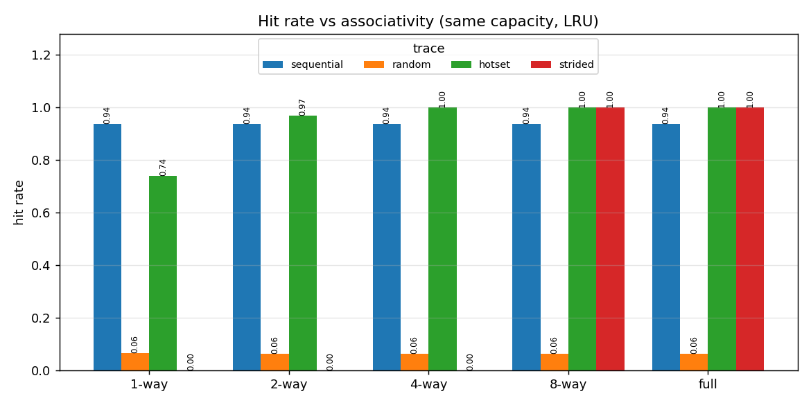
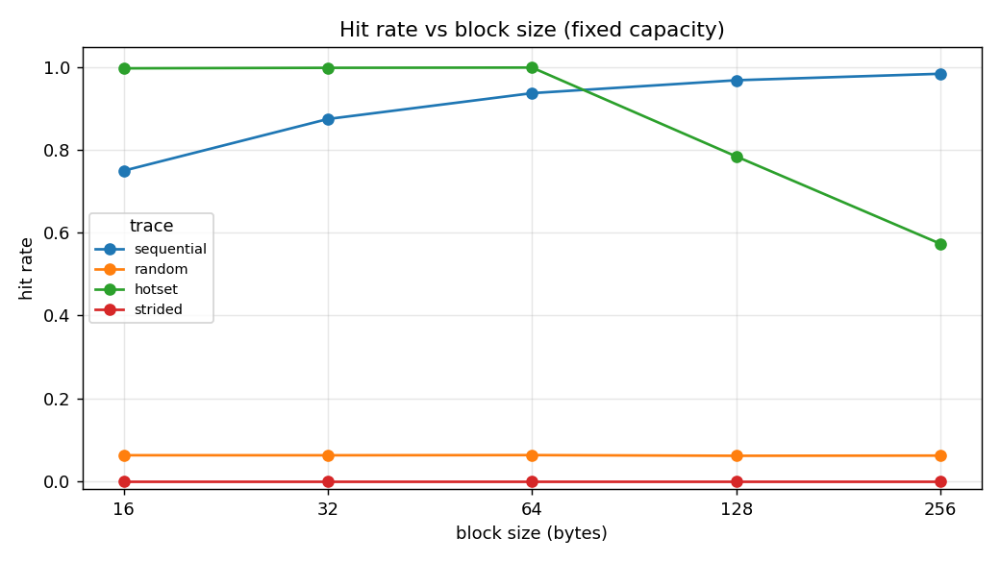
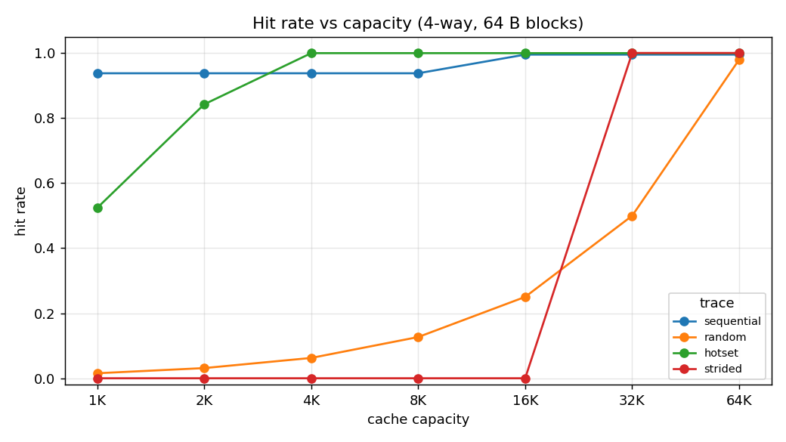
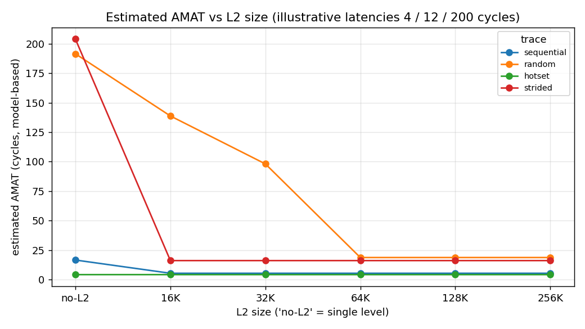
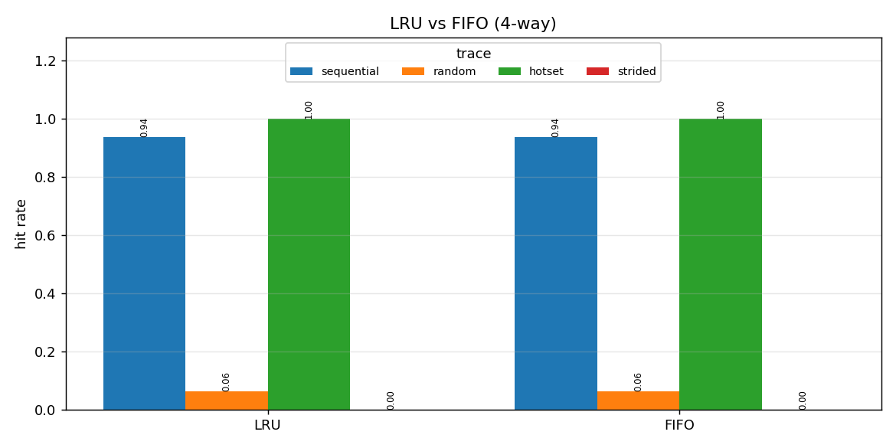
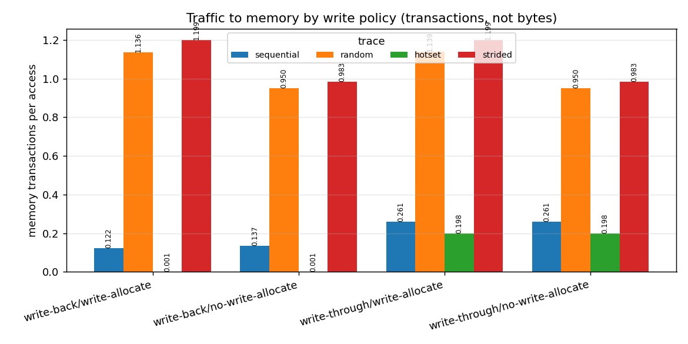

# CacheSim — CPU Cache Simulator

A configurable **CPU cache simulator built using C++17** to study cache behavior, memory access patterns, replacement policies, and performance trade-offs through trace-driven simulation.

CacheSim simulates memory accesses and reports cache hits, misses, evictions, memory traffic, and model-based Average Memory Access Time (AMAT). It supports configurable L1 and optional L2 caches, multiple replacement policies, and automated benchmarking.

## Features

- **Configurable cache:** Capacity, block size, and associativity.
- **Cache organizations:** Direct-mapped, set-associative, and fully associative.
- **Replacement policies:** LRU (Least Recently Used) and FIFO (First In, First Out).
- **Write policies:** Write-through and write-back.
- **Write allocation:** Write-allocate and no-write-allocate.
- **Multi-level cache:** Optional L2 cache configuration.
- **Performance statistics:** Hit rate, miss rate, evictions, memory transactions, and estimated AMAT.
- **Trace-driven simulation:** Parses read and write memory-access traces.
- **Synthetic trace generation:** Sequential, random, hot-set, and strided access patterns.
- **Automated benchmarking:** Sweeps cache parameters and exports results to CSV.
- **Visualization:** Python scripts using pandas and Matplotlib to plot benchmark results.
- **Testing:** CTest-based unit, differential, and end-to-end tests.

## Cache Concepts Visualized

The following plots illustrate how different cache parameters and policies influence simulated cache behavior.

### 1. Cache Associativity



Associativity determines how many cache lines can store blocks mapping to the same set. Higher associativity can reduce conflict misses, but its benefit depends on the access pattern.

### 2. Cache Block Size



Block size controls how much data is brought into the cache on a miss. Larger blocks can exploit spatial locality, but they also reduce the number of cache lines available at a fixed capacity.

### 3. Cache Capacity



Cache capacity affects how much data can remain available for reuse. Increasing capacity can reduce capacity-related and some conflict-related misses.

### 4. L2 Cache and AMAT



The optional L2 cache and latency model help explore how another cache level affects estimated average memory access time (AMAT).

### 5. Replacement Policies



LRU replaces the least recently used line, whereas FIFO replaces the line inserted earliest. Their relative performance depends on the memory-access sequence.

### 6. Write Policies



Write-through sends writes to the next memory level immediately. Write-back marks modified lines as dirty and writes them back when evicted. Write-allocation policies determine what happens on a write miss.

## Project Architecture

The project separates cache simulation logic from command-line handling, trace parsing, reporting, and benchmarking.

- **Cache:** Handles cache accesses, hits, misses, evictions, and replacement.
- **CacheConfig:** Validates cache parameters and supports address decomposition.
- **Simulation:** Coordinates cache levels and calculates model-based AMAT.
- **TraceParser:** Reads and validates memory-access traces.
- **TraceGenerator:** Generates deterministic synthetic workloads.
- **Statistics:** Tracks simulation metrics.
- **Report:** Produces text and CSV output.
- **Benchmark:** Runs parameter sweeps for performance comparisons.

## Project Structure

```text
CacheSim/
├── docs/
│   ├── img/
│   │   ├── associativity.png
│   │   ├── block_size.png
│   │   ├── capacity.png
│   │   ├── l2_amat.png
│   │   ├── replacement.png
│   │   └── write_policy.png
│   └── INTERVIEW_PREP.md
├── include/          # Header files
├── results/          # Sample benchmark results
├── scripts/          # Plotting scripts
├── src/              # C++ implementation
├── tests/            # Automated tests
├── traces/           # Sample memory-access traces
├── CMakeLists.txt
└── README.md
```

## Requirements

- C++17-compatible compiler
- CMake 3.14 or newer
- Python 3 and the dependencies in `scripts/requirements.txt` for plotting

The simulator itself does not require external C++ libraries.

## Build and Run

Run the following commands from the `CacheSim` project directory.

### Windows (PowerShell with CMake and a configured C++ compiler)

```powershell
cmake -S . -B build
cmake --build build --config Debug
ctest --test-dir build -C Debug --output-on-failure
```

Run the simulator:

```powershell
.\build\Debug\cachesim.exe --trace traces\sample.trace
```

### Linux / macOS

```bash
cmake -S . -B build
cmake --build build
ctest --test-dir build --output-on-failure
./build/cachesim --trace traces/sample.trace
```

## Example Commands

Run a simulation using the sample trace:

```bash
cachesim --trace traces/sample.trace
```

Enable CSV output:

```bash
cachesim --trace traces/sample.trace --csv
```

Configure cache capacity, block size, and associativity:

```bash
cachesim --trace traces/sample.trace --size 4K --block 32 --assoc 4
```

Use FIFO replacement:

```bash
cachesim --trace traces/sample.trace --replacement fifo
```

Configure write-through and no-write-allocate:

```bash
cachesim --trace traces/sample.trace --write-policy wt --write-miss no-allocate
```

Enable an L2 cache:

```bash
cachesim --trace traces/sample.trace --size 1K --assoc 2 --l2-size 8K --l2-assoc 4
```

View available command-line options:

```bash
cachesim --help
```

## Memory Trace Format

Each trace line contains an access type and a hexadecimal memory address.

```text
R 0x00001000
W 0x00002000
R 0x00001004
```

- `R` represents a read.
- `W` represents a write.
- Blank lines and comments beginning with `#` are supported.

## Benchmarking and Visualization

The benchmark executable sweeps cache configurations using the same input traces and writes results to CSV. The trace generator can create sequential, random, hot-set, and strided workloads.

The plotting script in `scripts/plot_results.py` uses pandas and Matplotlib to visualize benchmark results.

Install its Python dependencies with:

```bash
python -m pip install -r scripts/requirements.txt
```

Use the benchmark executable's help output to check its available options before running experiments.

## Testing

The project includes automated tests for cache configuration, address mapping, replacement policies, write policies, trace parsing, simulation behavior, benchmarking, and command-line functionality.

Run the test suite after building:

```bash
ctest --test-dir build --output-on-failure
```

On a Visual Studio Windows build, specify the configuration:

```powershell
ctest --test-dir build -C Debug --output-on-failure
```

## Limitations

- This is a functional cache simulator, not a cycle-accurate hardware simulator.
- AMAT is a model-based estimate using configurable latency assumptions.
- It does not model cache coherence, multicore execution, or detailed memory-system timing.
- It does not explicitly classify misses as compulsory, capacity, or conflict misses.
- Synthetic benchmark results illustrate cache behavior and should not be treated as measurements of real hardware.

## Technologies Used

**C++17 · CMake · Python · pandas · Matplotlib · CTest · Git**

## Learning Outcomes

- Understanding cache address decomposition into tag, set index, and block offset.
- Comparing direct-mapped, set-associative, and fully associative caches.
- Evaluating LRU and FIFO replacement strategies.
- Understanding write-through, write-back, and write-allocation policies.
- Exploring locality, memory traffic, cache hit rates, and estimated AMAT.
- Applying modular C++ design, automated testing, benchmarking, and data visualization.
